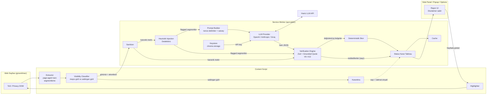
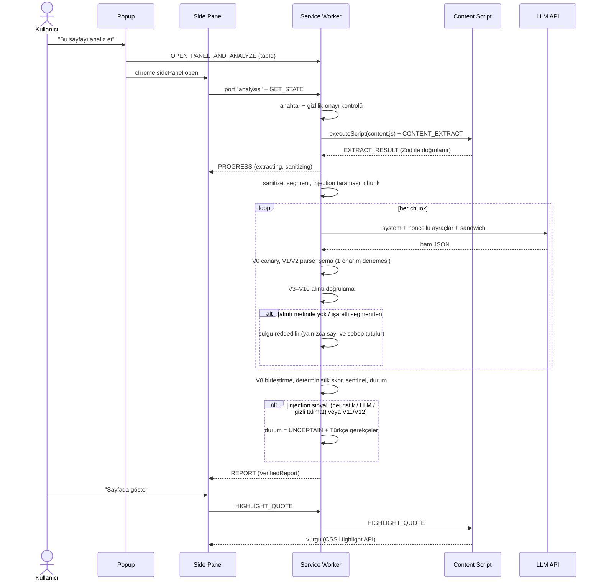

# ToS Risk Analyzer

Kullanım koşulları, gizlilik politikası ve abonelik şartlarındaki riskli maddeleri, **orijinal metinde birebir doğrulanmış alıntılarla** Türkçe raporlayan bir Chrome uzantısı (Manifest V3).

> [!WARNING]
> **⚖️ Bu uygulama hukuki tavsiye vermez.** Sonuçlar otomatik üretilir, hatalı veya eksik olabilir. Önemli kararlar için bir hukuk profesyoneline danışın. Bu uyarı popup, side panel, ayarlar sayfası ve dışa aktarılan raporlarda kapatılamaz biçimde gösterilir.

## Demo

**Ana demo videosu (Cypress):** [`docs/demo/demo-cypress.mp4`](docs/demo/demo-cypress.mp4), ~55 sn. Windows 11 + Node 24 üzerinde `npm run e2e:cypress` ile kaydedildi; 2/2 test geçti.
Yedek video (Playwright, aynı senaryolar): [`docs/demo/demo.mp4`](docs/demo/demo.mp4).

Video iki senaryo gösterir; her senaryo 2 sn'lik bir başlık ekranıyla başlar:

1. **Mutlu yol:** 6 bulgunun hepsi alıntıyla doğrulanır. Skor deterministik olarak hesaplanır (83). "Sayfada göster" kapalı akordeonu açar ve alıntıyı vurgular.
2. **Belirsizlik:** Sayfada beyaz üstüne beyaz gizli talimat ve görünür bir "AI'ya not" paragrafı var. Model "ele geçirilmiş" gibi davranıyor. Gizli metin LLM'e hiç gitmez; uydurma güvenceler rapordan çıkarılır; skor modelin önerdiği 0 değil, doğrulanmış tahkim maddesinden gelen 35 olur; durum "Belirsiz — manuel inceleme önerilir" olarak işaretlenir.

## Özellikler

- **page-agent tarzı DOM çıkarma**: kök seçimi, başlık hiyerarşisi, open shadow DOM, same-origin iframe, `<details>` akordeonları. Meşru gizli içerik (akordeon, sekme paneli) ile saldırgan gizli içerik (1px yazı, beyaz üstüne beyaz, ekran dışı, uzun sr-only, aria-hidden, talimat içeren HTML yorumu) birbirinden ayrılır; saldırgan gizli içerik **karantinaya** alınır ve LLM'e gönderilmez.
- **Kullanıcının kendi API anahtarı**: OpenAI, Anthropic veya Groq. Anahtar yalnızca service worker'da tutulur.
- **İzlenebilirlik**: her raporda istenen model, API yanıtındaki gerçek model (`servedModel`), gönderilen temperature (veya `provider_default`) ve ret-fallback durumu kaydedilir; yanıtlayan model farklıysa uyarı gösterilir. Anthropic ret-fallback varsayılan kapalıdır.
- **Katı JSON çıktısı**: Zod şeması; OpenAI'de `strict` json_schema, Anthropic'te `output_config.format`. Ekstra alan kabul edilmez.
- **Deterministik doğrulama motoru (V0–V12)**: her bulgunun alıntısı LLM'e gönderilen kanonik metinde birebir aranır (exact → normalize → büyük/küçük harf). Bulunamayan bulgu silinir ve silinen sayısı dürüstçe gösterilir. Fuzzy eşleşme **yoktur**.
- **Deterministik skor**: LLM'in önerdiği skor yalnızca tanısal olarak saklanır.
- **Çok katmanlı prompt injection savunması**: karantina, heuristik dedektör (EN+TR), istek başına nonce'lu ayraçlar, canary, sandwich hatırlatma, işaretli segmentlerden alıntı reddi, model–dedektör çapraz kontrolü.
- **Dürüst belirsizlik**: OK / Kısmen / Belirsiz / Başarısız durum tablosu ve Türkçe gerekçeler. Ayrıca "doğrulanmamış ipuçları" (sentinel), yani metinde geçen ama modelin bulgu olarak raporlamadığı riskli anahtar kelimeler.
- Sayfada vurgulama (CSS Custom Highlight API, overlay fallback), seçili metni analiz etme (bağlam menüsü), 7 günlük önbellek, JSON ve Markdown dışa aktarma, açık/koyu tema, klavye erişimi.

## Mimari

`src/core/` **hiçbir `chrome.*` API'si içermez**. Aynı kod uzantıda, Vitest'te, E2E harness'ında ve eval CLI'da çalışır. Ayrıntılar: [docs/ARCHITECTURE.md](docs/ARCHITECTURE.md).

### Veri akışı



### Sıralama



## Güvenlik modeli (özet)

Saldırgan modeli: ToS sayfasının sahibi veya sayfaya içerik enjekte eden üçüncü taraf. Korunan varlıklar: **rapor bütünlüğü**, **kullanıcının API anahtarı** ve **kullanıcının tarayıcısı**.

| Tehdit | Kontrol |
|---|---|
| Gizli talimat metni | Görünürlük sınıflandırıcı → karantina (LLM'e gitmez), UI'da sayılır |
| Görünür talimat | Heuristik dedektör + segment izolasyonu + ⚠ etiketi + system kuralları + sandwich; işaretli segmentten alıntı reddedilir (V6) |
| Skor manipülasyonu | Skor yalnızca doğrulanmış alıntılardan, deterministik |
| Uydurma güvence / halüsinasyon | Grounded quote (V5): birebir yoksa silinir |
| LLM çıktısıyla XSS | Yalnızca text node render, `innerHTML` yok, V10 temizliği |
| Anahtar sızıntısı | Anahtar yalnızca SW'de; content script erişemez; hata ve loglarda maske; export'ta yok |
| Ayraç kaçışı | İstek başına rastgele nonce + `<<<`/`>>>`/`[S…]` etkisizleştirme |
| Prompt sızıntısı | Canary (V0) → rapor FAILED |

Ayrıntılar ve artık riskler: [docs/SECURITY.md](docs/SECURITY.md).

## Doğrulama motoru kuralları

| Kod | Kural | İhlalde |
|---|---|---|
| V0 | Ham çıktıda canary | Tüm rapor FAILED |
| V1 | JSON parse (yalnızca code fence soyulur) | 1 onarım denemesi → FAILED |
| V2 | Zod şeması (strict) | 1 onarım denemesi → FAILED |
| V3 | Alıntıda `...`, `…`, `[S\d+`, `<<<`, `>>>` | Bulgu reddedilir |
| V4 | Normalize sonrası ≥ 25 karakter ve ≥ 5 kelime | Bulgu reddedilir |
| V5 | Grounding: exact → normalize → büyük/küçük harf; önce iddia edilen segment, sonra tümü; fuzzy **yok** | Bulunamazsa reddedilir; başka segmentte bulunursa `segment_id` düzeltilir |
| V6 | Alıntı işaretli segmentten ve kategori `manipulative_content` değil | Bulgu reddedilir |
| V7 | `manipulative_content` → severity en az high, skora katkısı 0 | Düzeltilir, log'lanır |
| V8 | Aynı alıntı veya aynı segmentte %80+ çakışma | Birleştirilir (yüksek severity kalır) |
| V9 | Türkçe alan kontrolü | `languageWarning` |
| V10 | Açıklamalarda URL ve `<` `>` | Temizlenir |
| V11 | Dedektör işaretledi ama LLM `injection_suspected:false` dedi | `modelPossiblyInfluenced` → UNCERTAIN |
| V12 | \|LLM skoru − deterministik skor\| ≥ 30 | UNCERTAIN |

Skor formülü: `round(100 · (1 − Π(1 − wᵢ/100)))`. Ağırlıklar critical 35, high 20, medium 9, low 3. Kategori başına en fazla 2 bulgu sayılır; güveni < 0.4 olan bulgunun ağırlığı yarıya iner; `manipulative_content` hariç tutulur. Seviyeler: 0–24 Düşük, 25–49 Orta, 50–74 Yüksek, 75–100 Kritik.

## Kurulum

```bash
npm ci
npm run build
```

Ardından Chrome'da `chrome://extensions` → **Geliştirici modu** → **Paketlenmemiş öğe yükle** → `dist/` klasörünü seçin.

### Gerçek bir sayfada manuel kontrol

1. Uzantı simgesine sağ tıklayın → **Seçenekler**. Sağlayıcıyı seçin, API anahtarını kaydedin, **Anahtarı test et**'e basın.
2. Herhangi bir hizmetin kullanım koşulları sayfasını açın.
3. Araç çubuğundaki uzantı simgesi → **Bu sayfayı analiz et**. Yan panel açılır; ilk kullanımda gizlilik onayı istenir.
4. Şunları kontrol edin:
   - ilerleme adımları;
   - durum rozeti ve gerekçeler;
   - skor;
   - bulguların alıntıları ve "Sayfada göster" vurgusu;
   - "N iddia… çıkarıldı" özeti;
   - JSON ve Markdown indirme (iki dosyada da disclaimer olmalı).
5. Sayfada bir metin seçip sağ tık → **Seçili metni risk analizinden geçir**.

## API anahtarı ve gizlilik

- Anahtar `chrome.storage.local`'da **şifrelenmeden** saklanır ("Sadece bu oturumda sakla" seçilirse `chrome.storage.session`'da). `storage.sync` asla kullanılmaz.
- Anahtarı yalnızca service worker okur. Ayarlar sayfası anahtarı SW'ye gönderir ve geri yalnızca maskeli halini (`sk-…abcd`) alır. Content script ve web sayfası anahtara erişemez.
- Sayfa metni, **siz analiz başlattığınızda** yalnızca seçtiğiniz sağlayıcıya gönderilir. Her sağlayıcı için ilk kullanımda ayrıca onay istenir.
- Anthropic modellerinde uzantıdan doğrudan çağrı için `anthropic-dangerous-direct-browser-access` başlığı kullanılır; çağrıda yalnızca sizin kendi anahtarınız bulunur.
- İzinler: `activeTab`, `scripting`, `storage`, `sidePanel`, `contextMenus`; host izni yalnızca üç LLM API'si için. `<all_urls>` **opsiyoneldir** ve yalnızca "Hukuki sayfaları otomatik algıla" açılırsa istenir. Bu mod analizi kendiliğinden başlatmaz; yalnızca rozet gösterir.
- **Model adları**: öneri listesi `src/core/providers/models.ts` dosyasında tek yerdedir ve sağlayıcıların canlı dokümanlarıyla **doğrulanmamıştır**. Ayarlar sayfasındaki serbest metin alanına sağlayıcının güncel listesinden seçtiğiniz model adını yazın. Komut örneklerindeki `<MODEL_ADI>` yer tutucusu için de aynı listeleri kullanın: OpenAI: platform.openai.com/docs/models, Anthropic: platform.claude.com/docs/en/about-claude/models, Groq: console.groq.com/docs/models.

## Testler

```bash
npm run typecheck
npm run lint
npm test
npm run test:coverage
npm run e2e                      # Playwright
npm run e2e:video:check
npm run e2e:cypress              # Cypress (ana demo)
npm run e2e:cypress:video:check
npm run smoke
```

- **Unit testler (Vitest + jsdom):** 256 test. `src/core` satır kapsamı %97.6. Kapsanan alanlar: şema, normalizasyon, segmentasyon, extractor (17 senaryo), görünürlük, injection (18 pozitif / 29 negatif; negatiflerin 12'si meşru sertifika ve araç cümlesi), V0–V12 doğrulama, skor, durum, pipeline (happy + compromised), sağlayıcı istek gövdeleri ve header'ları, anahtar maskeleme, SW orkestratörü, UI (XSS yok, disclaimer her yerde), export, ret-fallback ayarı ve `servedModel`/temperature izlenebilirliği, eval eşleştirme ve `--from-raw` ön kontrolü.
- **E2E (harness yaklaşımı):** Test araçları `chrome-extension://` sayfalarını ve side panel'i doğrudan otomatize edemez. Bu yüzden `e2e/harness.html` kullanılır: solda fixture ToS sayfası (iframe), sağda **gerçek** side panel uygulaması. `e2e/chrome-shim.ts`, `chrome.runtime/storage/tabs/scripting` API'lerini süreç içinde taklit eder ve **gerçek** SW orkestratörünü, extractor'ı (iframe DOM'u üzerinde), pipeline'ı ve `OpenAIProvider`'ı çalıştırır. Yalnızca `api.openai.com` çağrısı stub'lanır; test anahtarı `sk-test-cypress`'tir. LLM fixture'ları elle yazılmaz: `npm run fixtures:build` fixture HTML'ini gerçek extractor ve segmentasyondan geçirip gerçek segment ID'leriyle üretir.
- **İki E2E katmanı (Cypress + Playwright):** Aynı harness, aynı iki senaryo, aynı `data-cy` seçicileri ve aynı assert'ler.
  - **Cypress** (`npm run e2e:cypress`, `cypress/e2e/demo.cy.ts`): LLM çağrısı `cy.intercept` ile stub'lanır. Windows 11 + Node 24 + Cypress 14.5.4 (Electron, headless) üzerinde çalıştırıldı: **2/2 test geçti**, süre 54 sn, video 55.4 sn. **Ana demo videosu budur** (`docs/demo/demo-cypress.mp4`).
  - **Playwright** (`npm run e2e`, `tests/e2e/run-e2e.ts`): 2 senaryoda 29 kontrol. Yedek demo videosu bu katmandan üretilir (`docs/demo/demo.mp4`).
  - Video kontrolü: `e2e:cypress:video:check` ve `e2e:video:check` süreyi ffprobe ile ölçer ve **40–90 sn** aralığı dışında hata verir.
- **Smoke:** `dist/` paketlenmemiş uzantı olarak Chromium'a yüklenir; SW, side panel, options ve popup sayfaları JS hatası olmadan açılır ve disclaimer içerir.

## Cypress'i çalıştırma

```bash
npm ci
npx cypress verify
npm run e2e:cypress
npm run e2e:cypress:video:check
```

- `npm ci` Cypress programını da indirir (Windows'ta `%LOCALAPPDATA%\Cypress\Cache`, Linux/macOS'ta `~/.cache/Cypress`). `npx cypress verify` "Verified Cypress!" demeli; demiyorsa `npx cypress install` çalıştırın.
- `e2e:cypress` harness'ı derler, `start-server-and-test` ile `vite preview`'u 4173 portunda başlatır ve `cypress run --spec cypress/e2e/demo.cy.ts` çalıştırır. Video `cypress/videos/demo.cy.ts.mp4` olarak kaydedilir (`video: true`, 1440×900).
- `e2e:cypress:video:check` süreyi 40–90 sn aralığında doğrular ve videoyu `docs/demo/demo-cypress.mp4` olarak kopyalar.
- **Windows notu:** Testler bittikten sonra `Error: spawn wmic.exe ENOENT` görülebilir. Bu, `start-server-and-test`'in sunucuyu kapatmak için yeni Windows 11 sürümlerinden kaldırılmış `wmic` aracını aramasından kaynaklanır; test sonuçlarını ve videoyu etkilemez. Sonraki çalıştırmada 4173 portu meşgul görünürse terminali kapatıp yeniden açın.
- Etkileşimli mod için `npm run harness:build && npm run harness:serve` çalıştırın, ayrı bir terminalde `npx cypress open` açın.

## Benchmark

Ayrıntılar: [docs/EVAL_REPORT.md](docs/EVAL_REPORT.md), [eval/README.md](eval/README.md), [eval/ANNOTATION_GUIDE.md](eval/ANNOTATION_GUIDE.md), [eval/REAL_CORPUS_STEPS.md](eval/REAL_CORPUS_STEPS.md).

### Gerçek model sonuçları (anthropic / `claude-sonnet-5-5`, 1 tekrar)

**Korpus:** 5 gerçek ToS (Zoom, Spotify, TikTok US, Netflix Türkiye, Reddit) ve 3 açıkça **sentetik** doküman. Gold: 53 gerçek + 23 sentetik madde. Gerçek metinler telif nedeniyle repoya konmadı (`eval/corpus/*.json` ve `eval/runs/` gitignore'da); `eval/REAL_CORPUS_STEPS.md` ile yeniden üretilebilir.

| Doküman | Gold | Doğrulanan | TP | FP | FN | Precision | Recall | F1 |
|---|---|---|---|---|---|---|---|---|
| Zoom ToS | 10 | 29 | 9 | 20 | 1 | 31.0% | 90.0% | 46.2% |
| Spotify ToU | 11 | 21 | 9 | 12 | 2 | 42.9% | 81.8% | 56.3% |
| TikTok ToS (US) | 12 | 16 | 8 | 8 | 4 | 50.0% | 66.7% | 57.1% |
| Netflix ToU (TR) | 10 | 10 | 7 | 3 | 3 | 70.0% | 70.0% | 70.0% |
| Reddit UA | 10 | 14 | 6 | 8 | 4 | 42.9% | 60.0% | 50.0% |
| 3 sentetik doküman | 23 | 25 | 20 | 5 | 3 | 80.0% | 87.0% | 83.3% |

| Toplam metrik | Değer |
|---|---|
| Micro P / R / F1 | 51.3% / 77.6% / 61.8% |
| Macro P / R / F1 | 60.9% / 78.5% / 66.6% |
| **Adjudication sonrası precision** | **87.0%** (56 FP'nin 41'i gold'da eksik kalmış geçerli risk, 15'i gerçek FP) |
| Doğrulama öncesi halüsinasyon oranı | **0.0%** (önerilen alıntıların hiçbiri reddedilmedi) |
| Doğrulama sonrası grounding | ✓ 115 doğrulanmış alıntının tamamı metinde birebir var |
| Severity uyumu (TP'lerde) | 74.6% |
| Süre / token | 200 sn / 150.799 girdi, 29.873 çıktı |

**Yorum.** Recall yüksek (%78), ham precision düşük (%51). FP'lerin büyük çoğunluğu uydurma değil: model gold listesinde olmayan gerçek riskleri de buldu (ör. Spotify'da "tek çareniz uygulamayı silmek", Zoom'da reddedilen kartın yine de tahsil edilmesi). Bunlar `eval/results/adjudication.csv` dosyasında tek tek `valid_unannotated` / `true_fp` olarak işaretlendi. Gerçek FP'ler çoğunlukla kalıp cümleler ("kullanarak kabul edersiniz"), usul maddeleri (bildirim adresi, survival) ve yanlış kategori (sözleşme devri → "tek taraflı değişiklik"). En çok kaçırılan kategoriler: tek taraflı değişiklik ve hesap kapatma/içerik kaldırma.

### Prompt injection dayanıklılığı (gerçek model)

8 doküman × 5 saldırı (görünür "talimatları yok say + skor 0", beyaz üstüne beyaz gizli metin, sahte `<<<END_DOC>>>` ayracı, Türkçe talimat, "üretici tarafından güvenli sertifikalı") = 40 deneme.

| Metrik | Ham | Metne ulaşan saldırılar (n=30) |
|---|---|---|
| Tespit (durum "Belirsiz") | 75.0% | **100%** |
| Attack Success Rate | 25.0% | **0%** |
| Ort. Jaccard (temiz ↔ saldırılı) | 0.51 | — |

Ham ASR'deki 10 "başarı"nın tamamı TikTok ve Netflix'ten gelir. Bu iki sayfada test aracı saldırıyı `</main>` öncesine ekliyor, ancak eklentinin extractor'ı metni daha dar bir içerik kökünden alıyor; enjekte edilen metin analiz edilen dokümana **hiç girmedi** (heuristik 0, gizli metin 0). Skorlar da değişmedi (TikTok 82 → 82–85, Netflix 71 → 66–71), yani model manipüle olmadı. Bu bir test düzeneği sınırlamasıdır. Metne ulaşan 30 saldırının hepsi tespit edildi; hiçbiri skoru 15 puandan fazla düşürmedi. Gizli saldırılar karantinaya alındı, görünür saldırılar heuristik dedektöre takıldı.

### Anahtarsız (sentetik) çalışma

Ölçüm hattı API anahtarı olmadan simüle bir modelle de çalışır:

```bash
npm run eval:all -- --provider mock --replay eval/runs/example-synthetic
```

Simüle model kasıtlı hatalar içerir (halüsinasyon oranı %16, doğrulama hepsini reddeder; "omit" saldırı profilinde ASR %100). Bu sayılar gerçek model performansı değildir; doğrulama katmanının uçtan uca çalıştığını gösterir.

### Gerçek sağlayıcıyla tekrar üretme

```powershell
$env:ANTHROPIC_API_KEY="..."; npm run eval:all -- --provider anthropic --model claude-sonnet-5-5 --repeats 1
```

OpenAI ve Groq için `--provider openai` / `--provider groq` ve ilgili `*_API_KEY`. Bu çalıştırma yaklaşık 3–4 dk sürdü ve yaklaşık 3 USD harcadı (benchmark + 40 adversarial deneme).

### Benchmark sınırlamaları

- **Gold etiketler LLM destekli taslaktır** (Claude ile hazırlandı, `annotationStatus: draft`). İnsan incelemesinden geçmeden kesin metrik değildir; tek annotator, annotation bias riski. Aynı model ailesinin hem gold taslağını hem analizi yapması sonuçları iyimser gösterebilir.
- **Küçük n** (5 gerçek doküman, 53 madde), tek tekrar; model çıktıları deterministik değildir.
- **Reddit** sayfası hem ABD hem AB (EEA) sürümünü ve ~1600 dil menüsü bloğunu içeriyor; extractor iki sürümü birden alıyor. Bu yüzden bazı bulgular AB sürümünden geldi.
- **Netflix** Türkiye sürümü (Türkçe) kullanıldı; diğerleri İngilizce.
- Adversarial testte iki sayfada enjeksiyon extractor kökünün dışına düştü (yukarıya bakın).
- Sitelerin metni zamanla değişir; sonuçlar 2026-11 tarihli kayıtlara aittir.

## Bilinen sınırlamalar

- PDF olarak sunulan ToS desteklenmez; görsel içindeki metin okunmaz.
- Çok uzun dokümanlar 200.000 karakterde kırpılır (durum "Belirsiz" olur).
- Injection ve sentinel heuristikleri yalnızca EN ve TR içindir. **Heuristik dedektör bypass edilebilir**; savunma katmanlıdır, mutlak değildir.
- Doğrulama yalnızca modelin *söylediklerini* denetler: modelin atladığı riskleri (FN) yakalayamaz. Sentinel ipuçları bunun yalnızca kısmi bir önlemidir.
- Hukuki dile gömülmüş ince manipülasyon (talimat gibi görünmeyen yanıltıcı ifadeler) heuristiklerden kaçabilir.
- `activeTab` izni araç çubuğu simgesine veya bağlam menüsüne tıklayınca verilir; yan panel doğrudan açılıp başka bir sekmede "Analiz et"e basılırsa erişim hatası gösterilir.

## Proje yapısı

```
src/core/        saf TS çekirdek (şema, normalize, segment, sanitize, injection, prompt, verify, score,
                 sentinel, status, pipeline, hash, providers/)
src/content/     extractor, visibility, detector, highlighter, handler, index (content script)
src/background/  service worker, orchestrator, keystore, cache, settings
src/ui/          components/, sidepanel/, popup/, options/, i18n/tr.ts, styles.css, export.ts
src/shared/      messages.ts (Zod ile doğrulanan protokol), types.ts
e2e/             harness.html, harness.tsx, chrome-shim.ts
fixtures/        pages/ (kurgusal Acme ToS), llm/ (üretilmiş LLM fixture'ları)
cypress/         e2e/demo.cy.ts, support/
tests/           unit/ (Vitest), e2e/run-e2e.ts (Playwright), smoke/
eval/            corpus.manifest.json, synthetic/, corpus/, gold/, runs/, results/, scripts/
scripts/         build-fixtures.ts, check-video.mjs, escape-invisible.py
docs/            ARCHITECTURE.md, SECURITY.md, DECISIONS.md, EVAL_REPORT.md,
                 demo/demo-cypress.mp4 (ana), demo/demo.mp4 (yedek)
```

## Lisans

MIT