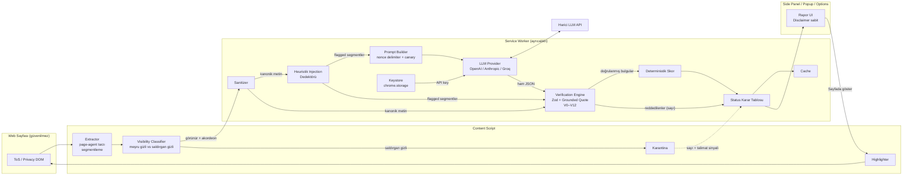
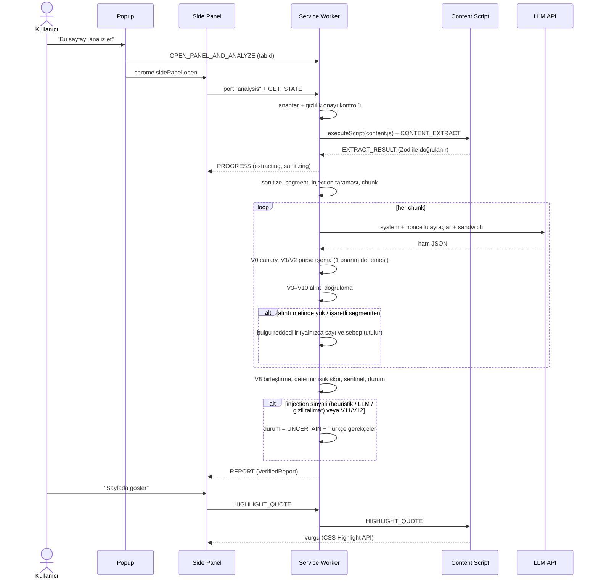

# ToS Risk Analyzer

Kullanım koşulları, gizlilik politikası ve abonelik şartlarındaki riskli maddeleri, **orijinal metinde birebir doğrulanmış alıntılarla** Türkçe raporlayan bir Chrome uzantısı (Manifest V3).

> [!WARNING]
> **⚖️ Bu uygulama hukuki tavsiye vermez.** Sonuçlar otomatik üretilir, hatalı veya eksik olabilir. Önemli kararlar için bir hukuk profesyoneline danışın. Bu uyarı popup, side panel, ayarlar sayfası ve dışa aktarılan raporlarda kapatılamaz biçimde gösterilir.

## Demo

[`docs/demo/demo.mp4`](docs/demo/demo.mp4) (~15 sn) iki senaryo gösterir:

1. **Mutlu yol:** 6 bulgunun hepsi alıntıyla doğrulanır. Skor deterministik olarak hesaplanır (83). "Sayfada göster" kapalı akordeonu açar ve alıntıyı vurgular.
2. **Belirsizlik:** Sayfada beyaz üstüne beyaz gizli talimat ve görünür bir "AI'ya not" paragrafı var. Model "ele geçirilmiş" gibi davranıyor. Gizli metin LLM'e hiç gitmez; uydurma güvenceler rapordan çıkarılır; skor modelin önerdiği 0 değil, doğrulanmış tahkim maddesinden gelen 35 olur; durum "Belirsiz — manuel inceleme önerilir" olarak işaretlenir.

<!-- Ekran görüntüsü / GIF yer tutucusu: docs/demo/screenshot.png -->

## Özellikler

- **page-agent tarzı DOM çıkarma**: kök seçimi, başlık hiyerarşisi, open shadow DOM, same-origin iframe, `<details>` akordeonları. Meşru gizli içerik (akordeon, sekme paneli) ile saldırgan gizli içerik (1px yazı, beyaz üstüne beyaz, ekran dışı, uzun sr-only, aria-hidden, talimat içeren HTML yorumu) birbirinden ayrılır; saldırgan gizli içerik **karantinaya** alınır ve LLM'e gönderilmez.
- **Kullanıcının kendi API anahtarı**: OpenAI, Anthropic veya Groq. Anahtar yalnızca service worker'da tutulur.
- **İzlenebilirlik**: her raporda istenen model, API yanıtındaki gerçek model (`servedModel`), gönderilen temperature (veya `provider_default`) ve ret-fallback durumu kaydedilir; yanıtlayan model farklıysa uyarı gösterilir. Anthropic ret-fallback varsayılan kapalıdır.
- **Katı JSON çıktısı**: Zod şeması; OpenAI'de `strict` json_schema, Anthropic'te `output_config.format`. Ekstra alan kabul edilmez.
- **Deterministik doğrulama motoru (V0–V12)**: her bulgunun alıntısı LLM'e gönderilen kanonik metinde birebir aranır (exact → normalize → büyük/küçük harf). Bulunamayan bulgu silinir ve silinen sayısı dürüstçe gösterilir. Fuzzy eşleşme **yoktur**.
- **Deterministik skor**: LLM'in önerdiği skor yalnızca tanısal olarak saklanır.
- **Çok katmanlı prompt injection savunması**: karantina, heuristik dedektör (EN+TR), istek başına nonce'lu ayraçlar, canary, sandwich hatırlatma, işaretli segmentlerden alıntı reddi, model–dedektör çapraz kontrolü.
- **Dürüst belirsizlik**: OK / Kısmen / Belirsiz / Başarısız durum tablosu ve Türkçe gerekçeler. Ayrıca "doğrulanmamış ipuçları" (sentinel), yani metinde geçen ama modelin bulgu olarak raporlamadığı riskli anahtar kelimeler.
- Sayfada vurgulama (CSS Custom Highlight API, overlay fallback), seçili metni analiz etme (bağlam menüsü), 7 günlük önbellek, JSON ve Markdown dışa aktarma, açık/koyu tema, klavye erişimi.

## Mimari

`src/core/` **hiçbir `chrome.*` API'si içermez**. Aynı kod uzantıda, Vitest'te, E2E harness'ında ve eval CLI'da çalışır. Ayrıntılar: [docs/ARCHITECTURE.md](docs/ARCHITECTURE.md).

### Veri akışı



### Sıralama



> Not: Bu ortamda Mermaid CLI kurulu değildi (yeni bağımlılık eklenmedi); diyagramların söz dizimi GitHub Mermaid ile uyumlu, sade bir alt kümeyle yazıldı. Görsel render kontrolü GitHub'da yapılmalıdır.

## Güvenlik modeli (özet)

Saldırgan modeli: ToS sayfasının sahibi veya sayfaya içerik enjekte eden üçüncü taraf. Korunan varlıklar: **rapor bütünlüğü**, **kullanıcının API anahtarı** ve **kullanıcının tarayıcısı**.

| Tehdit | Kontrol |
|---|---|
| Gizli talimat metni | Görünürlük sınıflandırıcı → karantina (LLM'e gitmez), UI'da sayılır |
| Görünür talimat | Heuristik dedektör + segment izolasyonu + ⚠ etiketi + system kuralları + sandwich; işaretli segmentten alıntı reddedilir (V6) |
| Skor manipülasyonu | Skor yalnızca doğrulanmış alıntılardan, deterministik |
| Uydurma güvence / halüsinasyon | Grounded quote (V5): birebir yoksa silinir |
| LLM çıktısıyla XSS | Yalnızca text node render, `innerHTML` yok, V10 temizliği |
| Anahtar sızıntısı | Anahtar yalnızca SW'de; content script erişemez; hata ve loglarda maske; export'ta yok |
| Ayraç kaçışı | İstek başına rastgele nonce + `<<<`/`>>>`/`[S…]` etkisizleştirme |
| Prompt sızıntısı | Canary (V0) → rapor FAILED |

Ayrıntılar ve artık riskler: [docs/SECURITY.md](docs/SECURITY.md).

## Doğrulama motoru kuralları

| Kod | Kural | İhlalde |
|---|---|---|
| V0 | Ham çıktıda canary | Tüm rapor FAILED |
| V1 | JSON parse (yalnızca code fence soyulur) | 1 onarım denemesi → FAILED |
| V2 | Zod şeması (strict) | 1 onarım denemesi → FAILED |
| V3 | Alıntıda `...`, `…`, `[S\d+`, `<<<`, `>>>` | Bulgu reddedilir |
| V4 | Normalize sonrası ≥ 25 karakter ve ≥ 5 kelime | Bulgu reddedilir |
| V5 | Grounding: exact → normalize → büyük/küçük harf; önce iddia edilen segment, sonra tümü; fuzzy **yok** | Bulunamazsa reddedilir; başka segmentte bulunursa `segment_id` düzeltilir |
| V6 | Alıntı işaretli segmentten ve kategori `manipulative_content` değil | Bulgu reddedilir |
| V7 | `manipulative_content` → severity en az high, skora katkısı 0 | Düzeltilir, log'lanır |
| V8 | Aynı alıntı veya aynı segmentte %80+ çakışma | Birleştirilir (yüksek severity kalır) |
| V9 | Türkçe alan kontrolü | `languageWarning` |
| V10 | Açıklamalarda URL ve `<` `>` | Temizlenir |
| V11 | Dedektör işaretledi ama LLM `injection_suspected:false` dedi | `modelPossiblyInfluenced` → UNCERTAIN |
| V12 | \|LLM skoru − deterministik skor\| ≥ 30 | UNCERTAIN |

Skor formülü: `round(100 · (1 − Π(1 − wᵢ/100)))`. Ağırlıklar critical 35, high 20, medium 9, low 3. Kategori başına en fazla 2 bulgu sayılır; güveni < 0.4 olan bulgunun ağırlığı yarıya iner; `manipulative_content` hariç tutulur. Seviyeler: 0–24 Düşük, 25–49 Orta, 50–74 Yüksek, 75–100 Kritik.

## Kurulum

```bash
npm ci
```

```bash
npm run build
```

Ardından Chrome'da `chrome://extensions` → **Geliştirici modu** → **Paketlenmemiş öğe yükle** → `dist/` klasörünü seçin.

### Gerçek bir sayfada manuel kontrol

1. Uzantı simgesine sağ tıklayın → **Seçenekler**. Sağlayıcıyı seçin, API anahtarını kaydedin, **Anahtarı test et**'e basın.
2. Herhangi bir hizmetin kullanım koşulları sayfasını açın.
3. Araç çubuğundaki uzantı simgesi → **Bu sayfayı analiz et**. Yan panel açılır; ilk kullanımda gizlilik onayı istenir.
4. Şunları kontrol edin:
   - ilerleme adımları;
   - durum rozeti ve gerekçeler;
   - skor;
   - bulguların alıntıları ve "Sayfada göster" vurgusu;
   - "N iddia… çıkarıldı" özeti;
   - JSON ve Markdown indirme (iki dosyada da disclaimer olmalı).
5. Sayfada bir metin seçip sağ tık → **Seçili metni risk analizinden geçir**.

## API anahtarı ve gizlilik

- Anahtar `chrome.storage.local`'da **şifrelenmeden** saklanır ("Sadece bu oturumda sakla" seçilirse `chrome.storage.session`'da). `storage.sync` asla kullanılmaz.
- Anahtarı yalnızca service worker okur. Ayarlar sayfası anahtarı SW'ye gönderir ve geri yalnızca maskeli halini (`sk-…abcd`) alır. Content script ve web sayfası anahtara erişemez.
- Sayfa metni, **siz analiz başlattığınızda** yalnızca seçtiğiniz sağlayıcıya gönderilir. Her sağlayıcı için ilk kullanımda ayrıca onay istenir.
- Anthropic modellerinde uzantıdan doğrudan çağrı için `anthropic-dangerous-direct-browser-access` başlığı kullanılır; çağrıda yalnızca sizin kendi anahtarınız bulunur.
- İzinler: `activeTab`, `scripting`, `storage`, `sidePanel`, `contextMenus`; host izni yalnızca üç LLM API'si için. `<all_urls>` **opsiyoneldir** ve yalnızca "Hukuki sayfaları otomatik algıla" açılırsa istenir. Bu mod analizi kendiliğinden başlatmaz; yalnızca rozet gösterir.
- **Model adları**: öneri listesi `src/core/providers/models.ts` dosyasında tek yerdedir. Claude kimlikleri Anthropic referansından alınmıştır (varsayılan `claude-opus-5-5`). OpenAI ve Groq önerilerinin güncelliği bu oturumda doğrulanamadı; ayarlar sayfasındaki serbest metin alanına sağlayıcının güncel model adını yazabilirsiniz.

## Testler

```bash
npm run typecheck
```

```bash
npm run lint
```

```bash
npm test
```

```bash
npm run test:coverage
```

```bash
npm run e2e
```

```bash
npm run e2e:video:check
```

```bash
npm run smoke
```

- **Unit testler (Vitest + jsdom):** 230 test. `src/core` satır kapsamı %97.5. Kapsanan alanlar: şema, normalizasyon, segmentasyon, extractor (17 senaryo), görünürlük, injection (16 pozitif / 17 negatif), V0–V12 doğrulama, skor, durum, pipeline (happy + compromised), sağlayıcı istek gövdeleri ve header'ları, anahtar maskeleme, SW orkestratörü, UI (XSS yok, disclaimer her yerde) ve export.
- **E2E (harness yaklaşımı):** Test araçları `chrome-extension://` sayfalarını ve side panel'i doğrudan otomatize edemez. Bu yüzden `e2e/harness.html` kullanılır: solda fixture ToS sayfası (iframe), sağda **gerçek** side panel uygulaması. `e2e/chrome-shim.ts`, `chrome.runtime/storage/tabs/scripting` API'lerini süreç içinde taklit eder ve **gerçek** SW orkestratörünü, extractor'ı (iframe DOM'u üzerinde), pipeline'ı ve `OpenAIProvider`'ı çalıştırır. Yalnızca `api.openai.com` çağrısı stub'lanır; test anahtarı `sk-test-cypress`'tir. LLM fixture'ları elle yazılmaz: `npm run fixtures:build` fixture HTML'ini gerçek extractor ve segmentasyondan geçirip gerçek segment ID'leriyle üretir.
- **İki E2E katmanı (Playwright + Cypress):** Aynı harness, aynı iki senaryo, aynı `data-cy` seçicileri ve aynı assert'ler.
  - **Playwright** (`npm run e2e`, `tests/e2e/run-e2e.ts`): sistemde önceden kurulu Playwright ve Chromium ile çalışır. 2 senaryoda 29 kontrol vardır. Demo videosu bu katmandan üretilir (`docs/demo/demo.mp4`).
  - **Cypress** (`npm run e2e:cypress`, `cypress/e2e/demo.cy.ts`): LLM `cy.intercept` ile stub'lanır. Geliştirme ortamında Cypress binary'si `download.cypress.io` erişimi olmadığı için indirilemedi; spec burada yalnızca tip kontrolünden geçti (`npm run typecheck:cypress`). Kendi makinenizde çalıştırma adımları aşağıda.
  - Video kontrolü: `e2e:video:check` (Playwright) ve `e2e:cypress:video:check` (Cypress → `docs/demo/demo-cypress.mp4`) süreyi ffprobe ile ölçer ve **40–90 sn** aralığı dışında hata verir.
- **Smoke:** `dist/` paketlenmemiş uzantı olarak Chromium'a yüklenir; SW, side panel, options ve popup sayfaları JS hatası olmadan açılır ve disclaimer içerir.

## Cypress'i kendi makinende çalıştırma

Cypress binary'si `download.cypress.io`'dan iner; bu adrese erişimi olan bir makinede:

```bash
npm ci
```

```bash
npx cypress verify
```

```bash
npm run e2e:cypress
```

```bash
npm run e2e:cypress:video:check
```

- `npm ci` Cypress binary'sini `~/.cache/Cypress` altına indirir. `npx cypress verify` "Verified Cypress!" demeli; demiyorsa `npx cypress install` çalıştırın.
- `e2e:cypress` harness'ı derler, `start-server-and-test` ile `vite preview`'u 4173 portunda başlatır ve `cypress run --spec cypress/e2e/demo.cy.ts` çalıştırır. Video `cypress/videos/demo.cy.ts.mp4` olarak kaydedilir (`video: true`, 1440×900).
- `e2e:cypress:video:check` süreyi 40–90 sn aralığında doğrular ve videoyu `docs/demo/demo-cypress.mp4` olarak kopyalar.
- Etkileşimli mod için `npm run harness:build && npm run harness:serve` çalıştırın, ayrı bir terminalde `npx cypress open` açın.

## Benchmark

Ayrıntılar: [eval/README.md](eval/README.md), [docs/EVAL_REPORT.md](docs/EVAL_REPORT.md), [eval/ANNOTATION_GUIDE.md](eval/ANNOTATION_GUIDE.md).

- **Korpus:** `eval/corpus.manifest.json` 5 gerçek şirket ToS kaydı (Zoom, Spotify, TikTok US, Netflix, Reddit) ve 1 gizlilik politikası içerir. Bu kayıtlar geliştirme ortamında **çekilemedi**: ağ politikası şirket sitelerine izin vermiyordu ve ağ erişimi eklenmedi. Kendi makinenizde `npm run eval:fetch` ile, bot engeli olursa `eval/raw/<id>.html` + `--from-raw` ile çekin.
- **Anahtarsız çalışma**, açıkça **sentetik** etiketli 3 kurgusal doküman ve bir **simüle model** ile yapılır. Simüle model kasıtlı hatalar içerir:

  ```bash
  npm run eval:all -- --provider mock --replay eval/runs/example-synthetic
  ```

  | Metrik (SENTETİK) | Değer |
  |---|---|
  | Micro P / R / F1 | 85.7% / 78.3% / 81.8% |
  | Doğrulama öncesi halüsinasyon oranı | 16.0% (simüle modelin 25 iddiasından 4'ü reddedildi) |
  | Doğrulama sonrası grounding (invariant) | ✓ 21/21 alıntı metinde |
  | Adversarial, "omit" profili | ASR 100%, tespit 100% |
  | Adversarial, "inflate" profili | ASR 0%, tespit 100% |

  Bu sayılar gerçek model performansını **göstermez**; ölçüm hattının ve doğrulama katmanının uçtan uca çalıştığını gösterir. "Omit" satırı önemli bir sınırlamayı ortaya koyar: model gerçek riskleri atlarsa doğrulama katmanı onları geri getiremez; savunma "Belirsiz" durumu ve sentinel ipuçlarıdır.
- **Gerçek sağlayıcı ile tek komut:**

  ```bash
  OPENAI_API_KEY=sk-... npm run eval:all -- --provider openai --model gpt-4.1 --repeats 1
  ```

- **Sınırlamalar:** küçük n; gold etiketler **LLM destekli taslaktır, insan incelemesinden geçmeden kesin metrik değildir (annotation bias riski)**; tek annotator; sitelerin metni değişebilir; model nondeterminizmi.

## Bilinen sınırlamalar

- PDF olarak sunulan ToS desteklenmez; görsel içindeki metin okunmaz.
- Çok uzun dokümanlar 200.000 karakterde kırpılır (durum "Belirsiz" olur).
- Injection ve sentinel heuristikleri yalnızca EN ve TR içindir. **Heuristik dedektör bypass edilebilir**; savunma katmanlıdır, mutlak değildir.
- Doğrulama yalnızca modelin *söylediklerini* denetler: modelin atladığı riskleri (FN) yakalayamaz. Sentinel ipuçları bunun yalnızca kısmi bir önlemidir.
- Hukuki dile gömülmüş ince manipülasyon (talimat gibi görünmeyen yanıltıcı ifadeler) heuristiklerden kaçabilir.
- `activeTab` izni araç çubuğu simgesine veya bağlam menüsüne tıklayınca verilir; yan panel doğrudan açılıp başka bir sekmede "Analiz et"e basılırsa erişim hatası gösterilir.

## Proje yapısı

```
src/core/        saf TS çekirdek (şema, normalize, segment, sanitize, injection, prompt, verify, score,
                 sentinel, status, pipeline, hash, providers/)
src/content/     extractor, visibility, detector, highlighter, handler, index (content script)
src/background/  service worker, orchestrator, keystore, cache, settings
src/ui/          components/, sidepanel/, popup/, options/, i18n/tr.ts, styles.css, export.ts
src/shared/      messages.ts (Zod ile doğrulanan protokol), types.ts
e2e/             harness.html, harness.tsx, chrome-shim.ts
fixtures/        pages/ (kurgusal Acme ToS), llm/ (üretilmiş LLM fixture'ları)
tests/           unit/ (Vitest), e2e/run-e2e.ts (Playwright), smoke/
eval/            corpus.manifest.json, synthetic/, corpus/, gold/, runs/, results/, scripts/
scripts/         build-fixtures.ts, check-video.mjs, escape-invisible.py
docs/            ARCHITECTURE.md, SECURITY.md, DECISIONS.md, EVAL_REPORT.md, demo/demo.mp4
```

## Lisans

MIT
